# MARIHAR - Video Downloader

[](https://www.gnu.org/licenses/gpl-3.0)
[](https://www.python.org/)
[](https://flask.palletsprojects.com/)

**A local, ad-free, open-source video downloader designed to give you greater control over your downloads.**

MARIHAR is a feature-rich video downloading application built with Python, Flask, yt-dlp, and FFmpeg. It combines a modern web interface with a Windows desktop application, allowing users to search for videos by title or URL and download media from YouTube, Facebook, Instagram, TikTok, and hundreds of other supported platforms.

Unlike online downloader websites, MARIHAR runs locally on your computer, without third-party advertisements or intrusive pop-ups. It gives users greater control over their downloads through flexible video and audio format selection, multiple audio track selection when available, and advanced subtitle integration with customizable appearance options.

From choosing the preferred audio language and subtitle presentation to downloading playlists or specific video sections, MARIHAR aims to provide a cleaner, more flexible, and user-controlled downloading experience.

**Built for users who want more control, fewer distractions, and a better way to manage their media downloads.**

## Why MARIHAR?

### The Story Behind the Project

MARIHAR was created to provide a more comfortable, flexible, and user-controlled video downloading experience.

Many online video downloader websites offer quick and convenient downloads, but they often come with intrusive advertisements, unnecessary pop-ups, and sometimes inappropriate advertising content. Beyond the advertising problem, they may also limit the user's control over certain video options.

One of the main reasons behind MARIHAR is the difficulty of selecting the preferred audio language when a video contains multiple audio tracks.

For example, a YouTube video may originally be in Russian but also include an automatically generated French audio track. Some online downloaders do not make it easy to select the desired audio track, which can result in downloading the video with its original Russian audio instead of the French version.

**MARIHAR aims to solve this problem by giving users greater control over available video and audio formats, including audio track selection when supported by the source and yt-dlp.**

### What Makes MARIHAR Different?

- **Ad-free experience:** No third-party advertisements or intrusive pop-ups within the application.
- **Local application:** Runs on your own computer instead of relying on an online downloader website.
- **Audio track selection:** Choose your preferred audio language when multiple audio tracks are available and accessible.
- **Greater control:** Select video quality, audio formats, subtitles, and other available download options.
- **Open source:** Freely available under the GNU GPL v3.0 license, allowing the community to inspect, use, improve, and contribute to the project.

**MARIHAR is more than a video downloader. It is an attempt to make video downloading cleaner, more flexible, and more respectful of the user's choices.**


## Screenshots & Application Overview

### 1. Application Startup

The splash screen introduces MARIHAR while the embedded local server initializes in the background. It presents the project logo and an animated title sequence, then offers a single **Accéder à MARIHAR** button that opens the main interface as soon as the backend is ready — so users never land on a half-loaded application.

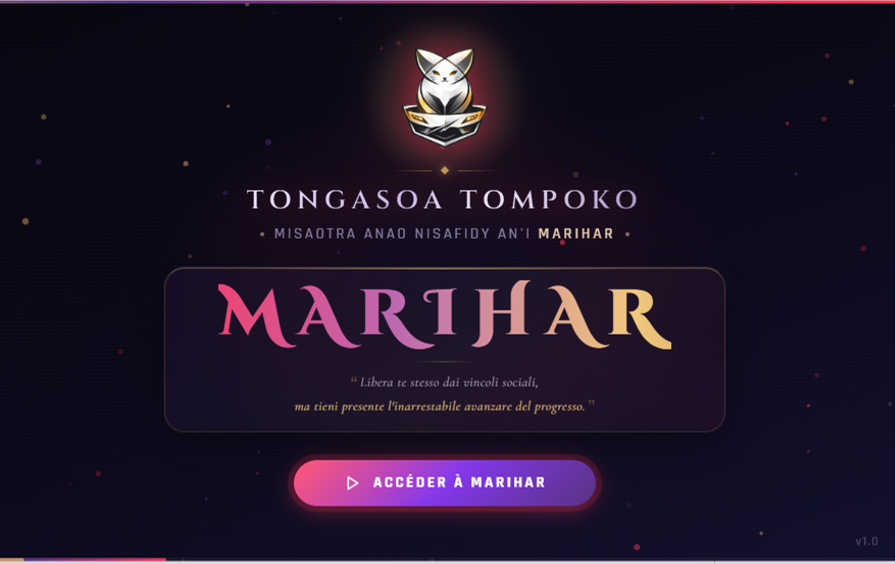

### 2. Main Download Interface

The home screen is where every download begins. Paste a video or playlist URL — or simply type a title to search for content, with a dropdown to choose how many results to scan. Quick-action buttons (**Coller** to read the clipboard, **Historique** to reuse a recent link) lead into the **Analyser** call-to-action, while the *Fichiers téléchargés* panel keeps track of everything already saved on the machine. Both themes are available:

| Dark Mode | Light Mode |
| :---: | :---: |
| 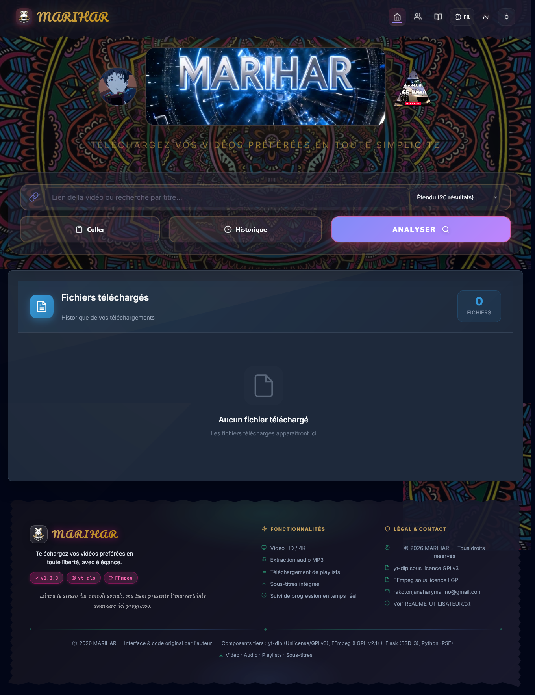 | 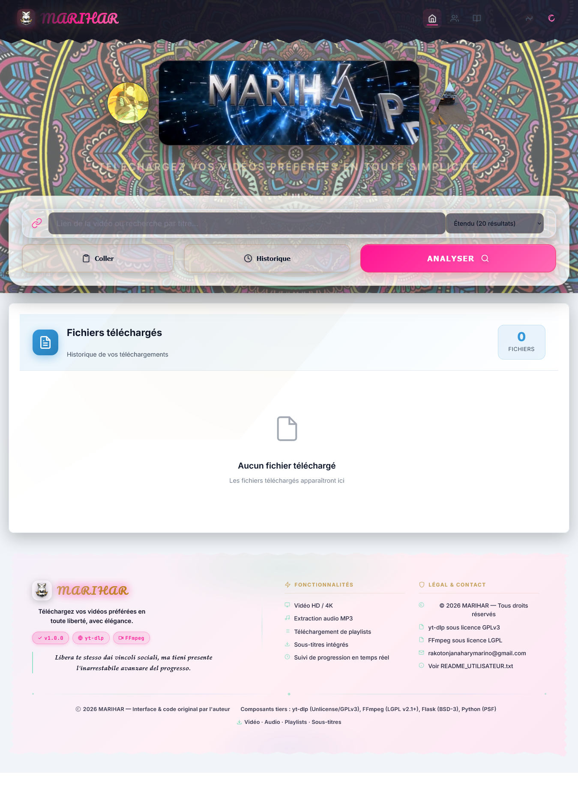 |

### 3. Download Management

Once a link is analyzed, the dashboard gathers every decision in one scrollable page: a video information card (thumbnail, title, channel, views, duration), selectable **video**, **audio**, and **combined** format tables showing codec, resolution, FPS, and estimated file size, a subtitle language picker, and advanced options such as subtitle embedding style, thumbnail/metadata inclusion, section extraction, output folder, and file naming.

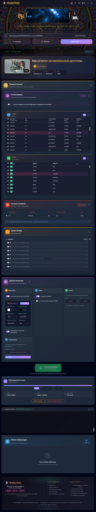

While a job runs, the progress panel keeps you informed at a glance: an animated bar with **Analyse → Téléchargement → Finalisation** stages, live size, speed, and remaining-time cards, **pause** and **cancel** controls, and a raw yt-dlp console for troubleshooting.

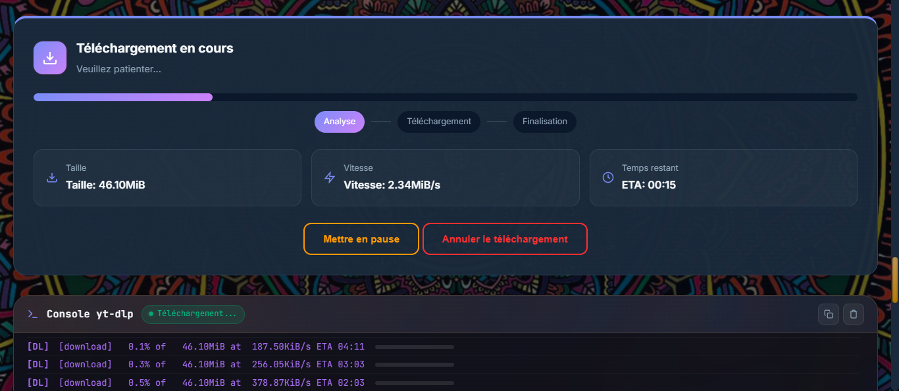

### 4. User Guide

MARIHAR ships an integrated, navigable tutorial ("Comment utiliser MARIHAR?"): five steps with progress indicators, practical tips on each screen, and a FAQ covering supported sites, legality, and playlist downloads. Beginners can learn the whole workflow without leaving the application or opening an external document.

| Dark Mode | Light Mode |
| :---: | :---: |
| 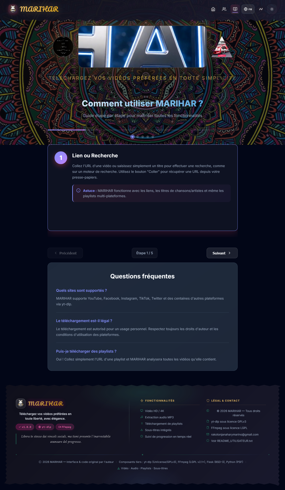 | 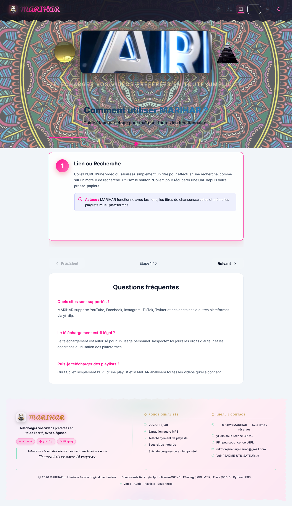 |

### 5. Update Manager

Because video platforms constantly change their protections, yt-dlp must stay current for downloads to keep working. The dedicated "Mise à jour & Configuration yt-dlp" page explains this and provides three actions from the navbar menu: a one-click **automatic update** of the bundled yt-dlp, selecting a **custom `yt-dlp.exe`** file, or **resetting to the default** version. The page also walks through the usage steps and gives practical advice.

| Dark Mode | Light Mode |
| :---: | :---: |
| 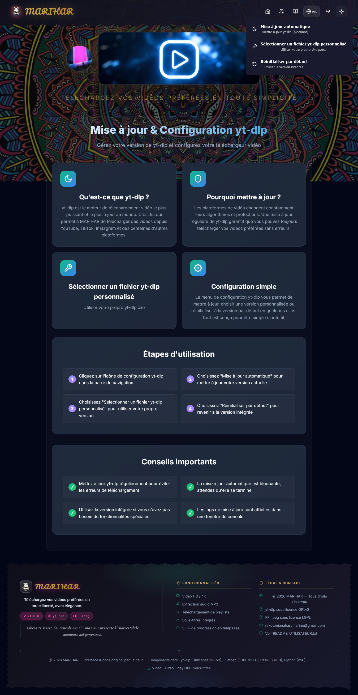 | 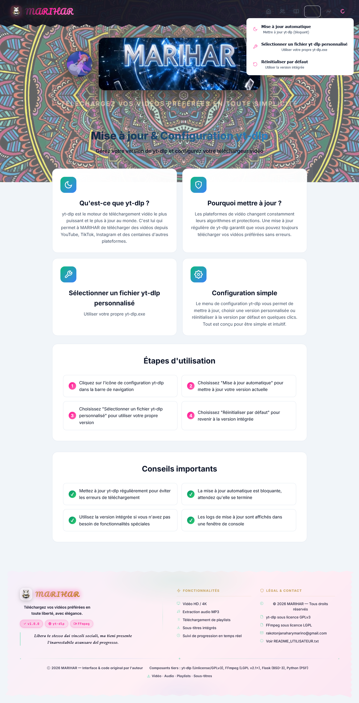 |

### 6. About MARIHAR

The "Qu'est-ce que MARIHAR?" page presents the project itself: its mission, its yt-dlp-based technology, its privacy promise (everything runs locally, no data is sent to external servers), its multilingual support, and a checklist of key features — 4K video downloads, high-quality MP3 extraction, multilingual and embedded subtitles, section downloads, and a modern interface. The application version is shown alongside the yt-dlp and FFmpeg badges in the footer.

| Dark Mode | Light Mode |
| :---: | :---: |
| 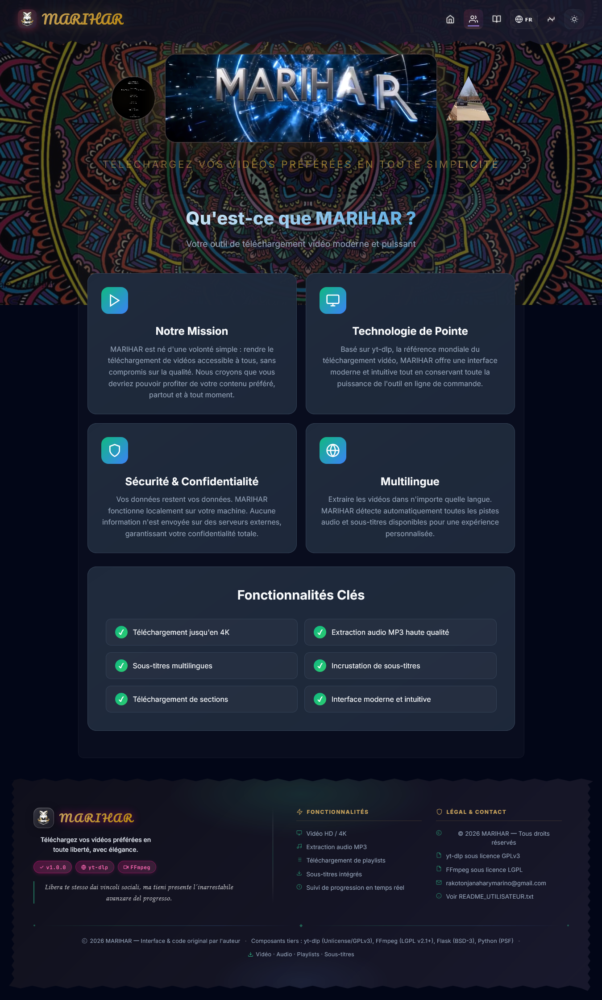 | 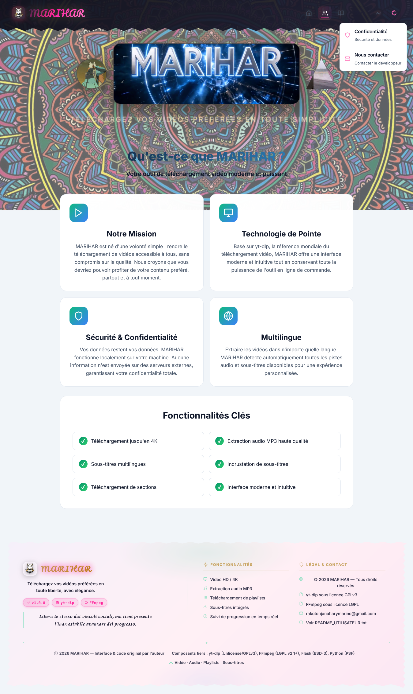 |

### 7. Application Demo Video

For a complete visual walkthrough, the demonstration video below shows MARIHAR in action: discovering the interface, searching for content, selecting formats, configuring options, and running downloads from start to finish. It is the quickest way for visitors to understand the general workflow before installing the application.

**▶ [Watch the MARIHAR demonstration video](https://github.com/user-attachments/assets/2abde8f5-9a2e-4cd2-8a23-91c89cfdb6d4)**

## Platform Support

**Windows** is the officially supported platform. External executables (yt-dlp, FFmpeg, Deno) must be downloaded separately - see [Binaries/README.md](Binaries/README.md) for instructions.

**Linux and macOS** are not yet officially tested or supported. If you want to contribute support for these platforms, please open an issue first to discuss the implementation approach.

## Features

- **Multi-platform support**: Download videos from YouTube, Facebook, Instagram, TikTok, and other platforms
- **Search by title or URL**: Find videos by entering a video title or download directly by pasting a video link
- **Format selection**: Choose from multiple video and audio formats
- **Subtitle support**: Download and embed subtitles in multiple languages
- **Dark/Light mode**: Modern UI with theme switching
- **Multi-language support**: Available in English, French, Italian, and Malagasy
- **Desktop application**: Native desktop app using PyWebView
- **Download management**: Pause, resume, and cancel downloads
- **Playlist support**: Download entire playlists
- **Section download**: Download specific sections of videos
- **Thumbnail embedding**: Embed video thumbnails in downloaded files

## Project Structure

```
MARIHAR/
├── Backend/              # Python Flask application
│   ├── app.py          # Main Flask application
│   ├── desktop_app.py  # PyWebView desktop app
│   ├── desktop_app_browser.py # Browser-based desktop app
│   ├── splash_screen.py # Splash screen for desktop app
│   ├── ytdlp_service.py # yt-dlp service
│   └── ytdlp_wrapper.py # yt-dlp wrapper
├── Frontend/            # Web interface
│   ├── static/         # CSS, JS, images, videos
│   │   ├── css/        # Stylesheets
│   │   ├── js/         # JavaScript files
│   │   ├── translations/ # i18n JSON files (en, fr, it, mg)
│   │   ├── Logo_marino.png, Background_mandala.jpg # UI assets (tracked)
│   │   └── *.mp4 # Intro videos (not tracked, see README note)
│   └── templates/      # HTML templates
│       └── index.html # Main application interface
├── Dependencies/       # Python requirements
│   ├── requirements.txt # Core dependencies (flask, flask-cors, yt-dlp)
│   └── requirements_desktop.txt # Desktop app dependencies (pywebview, pyinstaller)
├── Installation/       # Build and installation scripts
│   ├── build_desktop.bat # PyInstaller build script (Windows)
│   ├── marihar_installer.iss # Inno Setup installer script
│   └── start_server.bat # Quick server start script
├── Docs/              # Documentation
│   ├── README_UTILISATEUR.txt # User documentation (French)
│   ├── Plateformes_supportées.txt # Supported platforms list (yt-dlp)
│   ├── LICENSE.txt # End-user terms of service (French)
│   ├── licenses/ # Third-party license files
│   └── screenshots/ # Application screenshots (README gallery)
├── Assets/            # Desktop app assets
│   ├── Logo_marino.ico # Desktop app icon
│   └── Logo_marino.png # Desktop app logo
├── Binaries/          # External executables (Windows) - not in Git, see Binaries/README.md
│   ├── yt-dlp.exe # Video downloader (download from releases)
│   ├── ffmpeg.exe, ffplay.exe, ffprobe.exe # Multimedia tools (download from ffmpeg.org)
│   ├── deno.exe # JavaScript runtime (download from deno.land)
│   └── README.md # Download instructions
├── CONTRIBUTING.md    # Contribution guidelines
├── LICENSE.md         # GPL v3.0 license
├── MARIHAR.spec       # PyInstaller build specification
├── README.md          # This file - Project README
├── .env.example       # Environment configuration template
├── .gitattributes     # Git line-ending rules
└── .gitignore         # Ignored files (binaries, videos, venv, ...)
```


> **Note for developers**: the animated intro in the web interface uses three video files that are **not tracked in Git** (excluded by `.gitignore` to keep the repository light). They are referenced in `Frontend/templates/index.html` and must be placed in `Frontend/static/` with **exactly** these names, otherwise the animations will not play:
>
> - `Frontend/static/Left.mp4`
> - `Frontend/static/marihar_title.mp4`
> - `Frontend/static/Right.mp4`
>
> (`Logo_marino.png` and `Background_mandala.jpg` are already included in the repository and require no manual action.)

## Quick Start

### Option 1: Windows Installer (Recommended for Windows Users)

For the easiest installation on Windows, download the pre-built installer:

1. Download `MARIHAR_Setup_v1.0.0.exe` from the [GitHub Releases](https://github.com/MariharRM/MARIHAR/releases) page *(https://github.com/MariharRM/MARIHAR/releases/download/v1.0.0/MARIHAR_Setup_v1.0.0.exe)*
2. Run the installer
3. Follow the installation wizard
4. Launch MARIHAR from the Start menu or desktop shortcut

The installer includes all required dependencies (yt-dlp, FFmpeg, Deno) and does not require Python installation.

### Option 2: Manual Installation (Developers)

#### Prerequisites

- Python 3.8 or higher
- pip (Python package manager)
- **yt-dlp**: Download from [github.com/yt-dlp/yt-dlp/releases](https://github.com/yt-dlp/yt-dlp/releases) (Windows: place in `Binaries/yt-dlp.exe`) or install via `pip install yt-dlp`
- **FFmpeg**: Download from [ffmpeg.org](https://ffmpeg.org/download.html) (Windows: place ffmpeg.exe, ffplay.exe, ffprobe.exe in `Binaries/`)
- **Deno**: Download from [deno.land](https://deno.land/) (Windows: place deno.exe in `Binaries/`)

See [Binaries/README.md](Binaries/README.md) for detailed download instructions.

#### Installation Steps

1. Clone the repository:
```bash
git clone https://github.com/MariharRM/MARIHAR.git
cd MARIHAR
```

2. Download required binaries (yt-dlp, FFmpeg, Deno) - see [Binaries/README.md](Binaries/README.md) for detailed instructions

3. Create a virtual environment:
```bash
python -m venv venv
# On Windows:
venv\Scripts\activate
# On Unix/macOS:
source venv/bin/activate
```

4. Install dependencies:
```bash
pip install -r Dependencies/requirements.txt
```

5. Start the development server:
```bash
python Backend/app.py
```

The application will be available at `http://localhost:5000`

#### Desktop Application (Manual Installation)

For the desktop application, install additional dependencies:
```bash
pip install -r Dependencies/requirements_desktop.txt
python Backend/desktop_app.py
```

## Usage

1. Open the web interface at `http://localhost:5000`
2. Paste a video URL **or** type a video title in the input field
3. When searching by title, choose a search mode (number of YouTube results) and pick the video you want from the results list
4. Click "Analyze" to fetch video information
5. Select your preferred format and options
6. Click "Download" to start the download

## Configuration

### Custom yt-dlp Path

You can specify a custom path for yt-dlp:
- Go to Settings
- Enter the path to your yt-dlp executable
- The application will use this path for all downloads

### Download Location

By default, downloads are saved to your system's Downloads folder. You can change this in the settings.

## Supported Video Platforms

MARIHAR uses yt-dlp to download videos from hundreds of platforms, including:

- YouTube
- Facebook
- Instagram
- TikTok
- Twitter/X
- Vimeo

For the complete list of supported platforms, see [yt-dlp supported sites](https://github.com/yt-dlp/yt-dlp/blob/master/supportedsites.md).

## Languages

MARIHAR supports the following languages:
- English (en)
- French (fr)
- Italian (it)
- Malagasy (mg)

The language is automatically detected from your browser settings, but you can manually change it in the interface.

## Building

### Windows Desktop Application

To build a standalone Windows executable:

> **Note**: `build_desktop.bat` requires **Python 3.12** (it looks for `C:\Python312\python.exe` or `%LocalAppData%\Programs\Python\Python312\python.exe`), even though the web application itself runs on Python 3.8+.

1. **Download required binaries** (yt-dlp, FFmpeg, Deno) to the `Binaries/` folder - see [Binaries/README.md](Binaries/README.md)

2. **Build the executable**:
```bash
cd Installation
build_desktop.bat
```

This script will:
- Check Python installation
- Install required dependencies
- Verify all necessary files (including binaries in Binaries/)
- Build the executable using PyInstaller
- Create a `dist/MARIHAR/` folder with the application

For more details, see the build script comments or [CONTRIBUTING.md](CONTRIBUTING.md).

## Contributing

Contributions are welcome! Please see [CONTRIBUTING.md](CONTRIBUTING.md) for guidelines.

## License

This project is licensed under the GNU General Public License v3.0 - see the [LICENSE.md](LICENSE.md) file for details.

## Acknowledgments

- [yt-dlp](https://github.com/yt-dlp/yt-dlp) - Video downloader backend
- [FFmpeg](https://ffmpeg.org/) - Multimedia processing
- [Flask](https://flask.palletsprojects.com/) - Web framework
- [PyWebView](https://pywebview.flowrl.com/) - Desktop GUI framework

## Disclaimer

This tool is for personal use only. Please respect the copyright laws and terms of service of the platforms you download from. The authors are not responsible for any misuse of this software.

## Documentation

For detailed user documentation (in French), see `Docs/README_UTILISATEUR.txt`.

For developer documentation, see [CONTRIBUTING.md](CONTRIBUTING.md).

## Known Limitations

- **Platform Support**: Currently only Windows is officially supported with bundled executables
- **Download Speed**: Speed depends on your internet connection and the source platform
- **Format Availability**: Not all formats are available for all videos (depends on the source)
- **Subtitle Availability**: Subtitles may not be available for all videos or in all languages
- **Age-Gated Content**: Some platforms may require authentication for age-gated content

## Roadmap

MARIHAR is an evolving open-source project. The following roadmap outlines planned improvements and future development goals. Priorities may change as the project evolves and community feedback is received.

### Security & Reliability

- [ ] Strengthen local API security, including restricting file access to the downloads directory and configuring CORS for trusted localhost origins
- [ ] Review the use of `--no-check-certificate` in yt-dlp calls and limit it to a documented opt-in workaround
- [ ] Replace debugging `print()` statements with structured Python logging, respecting the `LOG_LEVEL` environment variable
- [ ] Implement or properly document the configuration variables defined in `.env.example` (`FLASK_PORT`, `DOWNLOADS_DIR`, etc.)
- [ ] Introduce automated tests with `pytest` for the core download service
- [ ] Set up GitHub Actions for automated testing and Windows build verification

### User Experience & Download Management

- [ ] Improve the user interface (visual polish, responsiveness, and accessibility)
- [ ] Improve error handling and user feedback
- [ ] Introduce download queue management (ordering, configurable concurrency limit, pending status)
- [ ] Implement automatic port fallback when the default port is unavailable
- [ ] Complete the Malagasy translation and consider adding more languages

### Architecture & Maintainability

- [ ] Refactor large modules such as `ytdlp_service.py` and `app.js` into smaller, more maintainable components
- [ ] Implement periodic cleanup of outdated download tasks and analysis caches
- [ ] Remove hardcoded Python paths from `build_desktop.bat`

### Cross-Platform Support

- [ ] Develop and test Linux compatibility
- [ ] Develop and test macOS compatibility

### Community & Contributions

- [ ] Introduce a project changelog
- [x] Add GitHub issue and pull request templates
- [ ] Improve contribution guidelines and documentation

## Support

For issues, questions, or contributions, please open an issue on [GitHub](https://github.com/MariharRM/MARIHAR/issues).

---

**Note**: This is an open-source project. If you find it useful, consider giving it a star on GitHub!


